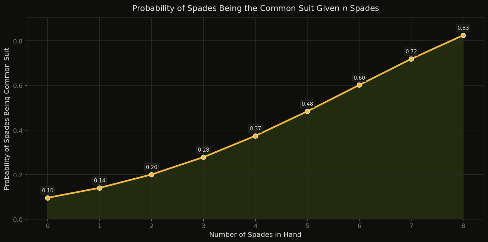
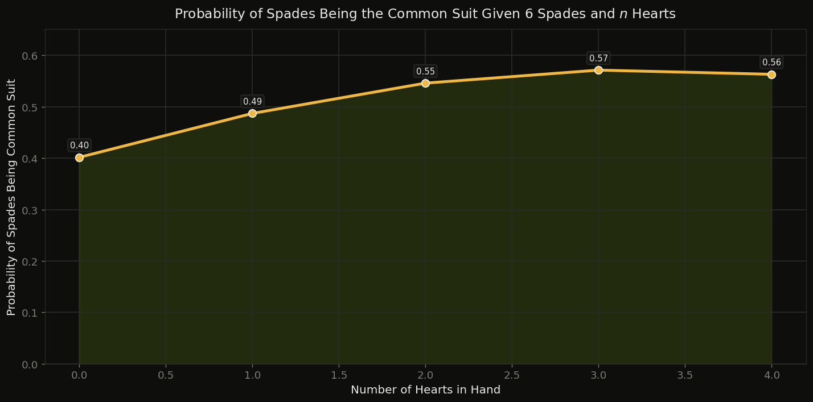
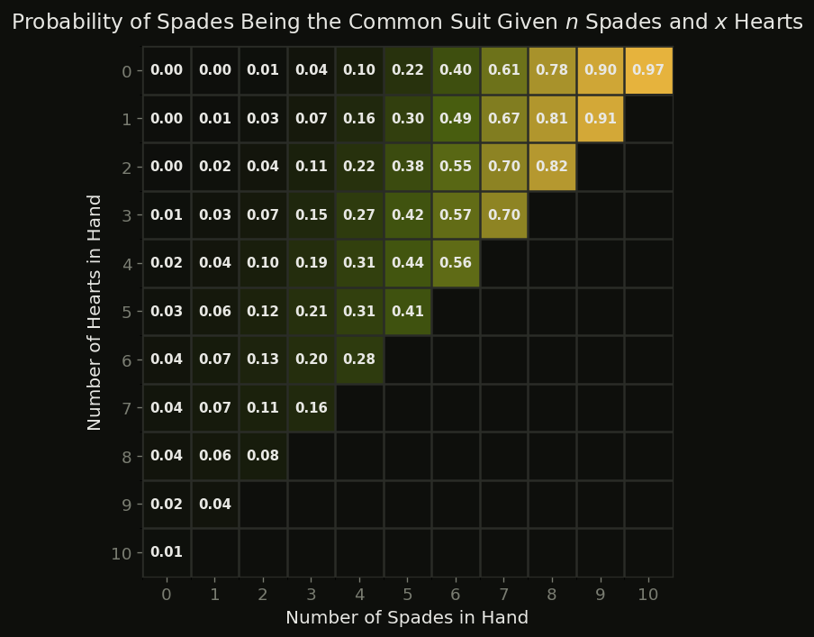
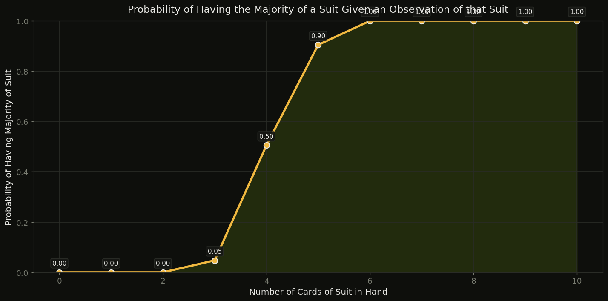
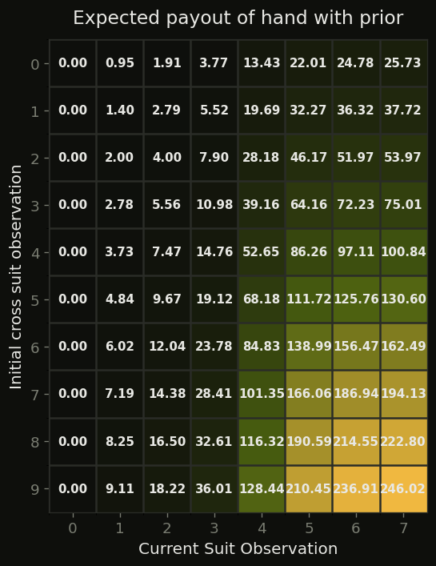
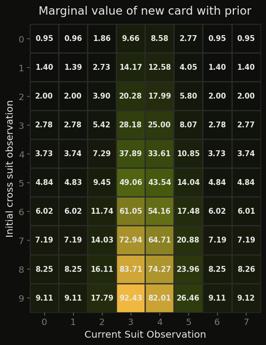
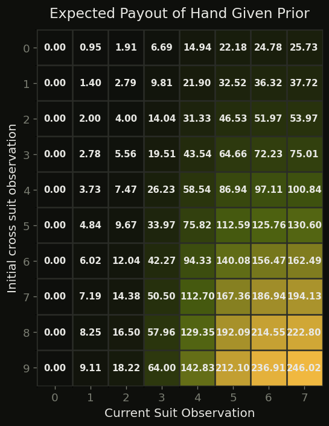
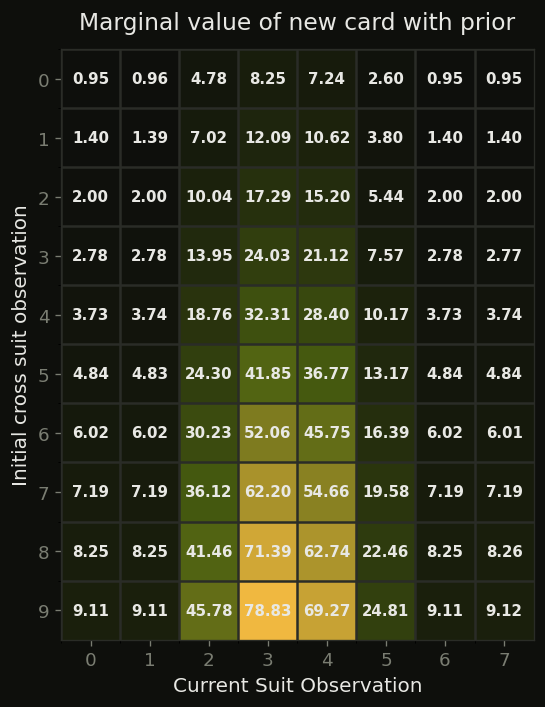

::: {.hero-tag}
Jane Street · Market Microstructure · Quant Training
:::

Trying to understand the math behind Figgie, and optimizing to win.

::: {.hero-links}
[↗ Rules](https://www.figgie.com/how-to-play.html){.btn .btn-figgie-primary target="_blank"}
[↗ Background Reading](https://www.loganseaburg.com/blog/figgie-1-background){.btn .btn-figgie-outline target="_blank"}
[↗ Research Paper](https://arxiv.org/pdf/2110.00879){.btn .btn-figgie-outline target="_blank"}
[↗ Notebooks & Code](https://github.com/FloorMan/figgie-insights){.btn .btn-figgie-outline target="_blank"}
:::

:::: {.status-bar}
::: {.status-item}
[Status]{.status-label}
[In Progress]{.status-value}
:::
::: {.status-item}
[Probabilities]{.status-label}
[✓ Done]{.status-value}
:::
::: {.status-item}
[Expected Value]{.status-label}
[In Progress]{.status-value .warn}
:::
::: {.status-item}
[Simulation]{.status-label}
[Pending]{.status-value .dim}
:::
::: {.status-item}
[RL Model]{.status-label}
[Pending]{.status-value .dim}
:::
::::

## Statistical Analysis {#statistical-analysis}

To understand how to get better at the game, we must first understand our odds. Seeing how the cards are distributed can give us a leg up when making decisions. Everything flows downstream from knowing how likely a given hand composition is, and what it implies about the hidden state of the deck.

:::::: {.figgie-cards}
::: {.figgie-card}
[♠]{.card-suit .spade}
[Deck Structure]{.card-title}

40 cards across 4 suits. One suit has 12 cards (the *common* suit), two suits have 10, and one has 8. Each player is dealt 10 cards.
:::

::: {.figgie-card}
[♥]{.card-suit .heart}
[Target Suit]{.card-title}

The target suit is the other suit of the common suit's color: ♠↔♣ and ♥↔♦. If ♠ has 12, ♣ is the target. Each target card pays \$10 from the \$200 pot, and whoever holds the most target cards takes the rest.
:::

::: {.figgie-card}
[♦]{.card-suit .diamond}
[Hidden Information]{.card-title}

Neither the common suit nor the target is revealed. Players must infer them from hand composition, market behavior, and sequential Bayesian updating.
:::

::: {.figgie-card}
[♣]{.card-suit .club}
[Information Edge]{.card-title}

Superior inference about the target suit (or about what *others* believe) is the core alpha. This is a game about epistemics as much as trading.
:::
::::::

## Bayesian Inference {#bayesian}

### Starting Hand {#starting-hand}

The most important suit in the game is the target suit. This is the only suit that gets scored at the end of the round, and it can often swing a losing round into a winning game. To find the target suit, we need to find the common suit, which always has 12 cards.

The common suit will be a randomly picked suit, made up of 12 cards. Since the common suit has the most cards, implicitly we know that we are more likely to hold a lot of the common suit than of any other suit.

In Figgie, the common suit is hidden from us. If we draw 6 hearts, 2 spades, 1 diamond, and 1 club, we would assume that hearts is the common suit, since we are more likely to be dealt a higher number of the common suit than any other suit. But what are the odds exactly? What is the probability of hearts being the common suit given I'm dealt $n$ hearts?

Using Bayes' formula, we can calculate the conditional odds of a single suit being common, given a certain number of cards being dealt.

$$P(A \mid B) = \frac{P(B \mid A) \cdot P(A)}{P(B)}$$

For a given number of cards dealt $K$ from suit $S$, we want to determine the probability that $S$ is the common suit $C$:

$$P(C = S \mid K_S = n) = \frac{P(K_S = n \mid C = S) \cdot P(C=S)}{P(K_S = n)}$$

The probability that our given suit is the common suit is uniformly distributed:

$$P(C=S) = \frac{1}{\text{Total Suits}} = \frac{1}{4}$$

The probability of $n$ cards being dealt from suit $S$ is the number of combinations that give us $n$ cards of $S$ over the total number of possible hands. This gets particularly tricky when we consider that our suit could hold 12, 10, or 8 cards in the deck. To find the overall probability, we add together the case where our suit $S$ is common and the cases where $S$ is not common.

In the case where $S$ is common, there is only one way the suit could be made up ($S$ has 12 cards total). We count the ways to choose $n$ cards from $S$ and the rest of the hand from the other 28 cards:

$$\text{Combinations of } n \text{ cards from } S \mid \text{Common} = \binom{12}{n} \cdot \binom{40-12}{10-n}$$

To find the probability, we divide these combinations by the total number of hands:

$$P(K_S=n \mid C=S) = \frac{\binom{12}{n} \cdot \binom{40-12}{10-n}}{\binom{40}{10}}$$

In the case where $S$ is not common, there are 2 different ways that $S$ could be made up: 10 cards or 8 cards. Of the three non-common suits, two have 10 cards and one has 8, so given $S$ isn't common, it has 10 cards with probability $\frac{2}{3}$ and 8 cards with probability $\frac{1}{3}$.

$$\text{Combinations of } n \text{ cards} \mid \text{Not Common, 10 cards} = \binom{10}{n} \cdot \binom{40-10}{10-n}$$

$$\text{Combinations of } n \text{ cards} \mid \text{Not Common, 8 cards} = \binom{8}{n} \cdot \binom{40-8}{10-n}$$

We weight these two cases by how likely each one is, and divide by the total number of possible hands:

$$P(K_S = n \mid C \neq S) = \frac{2}{3} \cdot \frac{\binom{10}{n} \binom{40-10}{10-n}}{\binom{40}{10}} + \frac{1}{3} \cdot \frac{\binom{8}{n} \binom{40-8}{10-n}}{\binom{40}{10}}$$

To find the total probability of being dealt $n$ cards of $S$, we add together these probabilities by their weights:

$$P(K_S = n) = P(K_S=n \mid C=S) \cdot P(C=S) + P(K_S=n \mid C \neq S) \cdot P(C \neq S)$$

Finally, we can reconstruct our probability of $S$ being the common suit:

$$P(C = S \mid K_S = n) = \frac{P(K_S = n \mid C = S) \cdot P(C=S)}{P(K_S = n)}$$

Below is the result of our calculations for each number $n$ dealt.

{#fig-common-n fig-alt="Line chart: the probability that spades is the common suit rises from 0.10 with 0 spades to 0.83 with 8 spades."}

### All Cards Give Us Information {#multi-suit}

We also have to consider the other cards in our starting hand, as these could also give us a leg up when evaluating our probability. Holding spades *and* hearts jointly updates our posterior across all four suit hypotheses. What happens if we have 7 spades and 2 hearts? How does this change our probability?

{#fig-common-hearts fig-alt="Line chart: with 6 spades, the probability that spades is common rises from 0.40 with 0 hearts to about 0.57 with 3 hearts."}

{#fig-common-heatmap fig-alt="Heatmap of the probability that spades is common, by number of spades (x) and hearts (y) in hand."}

> Figgie is a game about information, not just cards. The hand is the prior; the market is the evidence.
>
> <cite>Inspired by the Jane Street Figgie community</cite>

## Expected Value & Rational Pricing {#ev}

One cannot win on probability alone. We have calculated the approximate probability of holding the common suit on the first draw, but the aim of the game is to end up with the most money. Knowing the common suit is only helpful because it lets us find the target suit, which is the only suit that awards chips at the end of the round.

Going off of our priors (we will implement a model for updating our priors later on), we will find the marginal value of buying cards, the expected payout at the end of a round, and determine a policy to find the best price for buying a card.

### Marginal Value per Card {#marginal-value}

The marginal value of a card is the expected value of the end-of-round payoff that buying a single card will give us.

Let:

- $X$ be the suit
- $T$ be the target suit
- $M$ be the majority
- $H_X$ be the number of cards of suit $X$ in your hand

$$EV_X = P(T=X) \left(10 \cdot \mathbb{E}[H_X \mid T=X] + 200 \cdot P(M \mid T=X)\right)$$

Our expected value for buying a card of suit $X$ is the combination of two terms: the payout per target card, and the payout for the majority pot. The payout per card at the end of the round is linear, but the probability of having the majority of suit $X$ at the end of the round is non-linear and discrete, due to the possibility of ties.

Starting with $10 \cdot \mathbb{E}[H_X \mid T=X]$, this represents our expected winnings from the target cards in our hand. Given our suit $X$ is the target suit $T$, we multiply each card in hand by the payout at the end of the round (each target card receives \$10).

Our next term, $200 \cdot P(M \mid T=X)$, represents the probability of winning the pot, given that our suit $X$ is the target suit $T$ (the pot is worth \$200). We first look at our current hand of the target suit. Since we have $n$ cards in our hand, there must be $10-n$ cards split among the other players with ⅔ probability, or $8-n$ cards split among the other players with ⅓ probability. In either case, we can compute every way of splitting the cards among players and tally the cases where we have the majority of the target suit. We then divide that by our total space (total variations), weight those probabilities appropriately (⅔ for the 10-card case and ⅓ for the 8-card case), and add them together to find our total probability of holding the majority.

$$P(M \mid T=X, K_X=10, H_X = n) = \frac{\text{Num } n \text{ majority for 10 cards}}{\text{Total distributions of 10 cards}}$$

$$P(M \mid T=X, K_X=8, H_X = n) = \frac{\text{Num } n \text{ majority for 8 cards}}{\text{Total distributions of 8 cards}}$$

$$P(M \mid T=X, H_X = n) = P(M \mid T=X, K_X = 10, H_X = n) \cdot \frac{2}{3} + P(M \mid T=X, K_X = 8, H_X = n) \cdot \frac{1}{3}$$

{#fig-majority fig-alt="Line chart: probability of majority is 0 for 0 to 2 cards, 0.05 at 3, 0.50 at 4, 0.90 at 5, and 1.0 from 6 cards on."}

Combining the prior on the target suit with the payout terms gives the expected payout of a hand, and the difference between adjacent columns gives the marginal value of picking up one more card. The *cross suit* is the other suit of the same color: the more of it we hold, the more likely it is the common suit, which makes our suit the target.

::: {.fig-pair}
{#fig-ev-prior fig-alt="Heatmap of expected payout by cards of the suit held (x) and initial cross-suit observation (y)."}

{#fig-mv-prior fig-alt="Heatmap of marginal value of one more card, peaking when going from 3 to 4 cards."}
:::

### Accounting for Ties {#ties}

However, this does not account for the possibility of a tie. We could end up in a scenario where we and another player both have 4 cards of the target suit, or even where 3 players share the majority. To account for this, we need to update our expected value.

$$200 \cdot P(M) + 200 \cdot \mathbb{E}\left[\tfrac{1}{k} \mid M=M_i\right] \cdot P(M=M_i)$$

Here we have two terms. The first is the expected value of the pot given we have the outright majority, and the second is the expected value of the pot given that we tie. Since having the outright majority and being in a tie are mutually exclusive, we can simply add the expected value of a tie into our model.

In the case of a tie, the pot is split evenly among the players who collected the most target cards. For example, if the target $T$ was hearts, and player two and I both collected 4 hearts, we would split the pot evenly. To model this expected value, we want to find the expected value of $\frac{1}{k}$, where $k$ is the number of players who tied.

::: {.fig-pair}
{#fig-ev-ties fig-alt="Heatmap of expected payout including split pots."}

{#fig-mv-ties fig-alt="Heatmap of marginal value including ties; value is spread more evenly across 2 to 4 cards."}
:::

::: {.callout-note title="Work in progress"}
The tie derivation is still being written up. Next up: turning marginal value into a bid/ask policy.
:::

## Game Server {#game-server}

For this project, I've elected to write the **server in Rust** for efficiency and concurrency, speeding up analysis. I will implement the real-time game engine and traders in Rust, and store all game results and game states in a PostgreSQL database. We will connect to the game engine via WebSockets to display analytics in a dashboard.

The work in progress lives in the [`server/` folder of the project repo](https://github.com/FloorMan/figgie-insights/tree/main/server).

## Efficiency & Information Flow {#information-flow}

Markets in Figgie are short (4 minutes), noisy, and played by humans under pressure. This section will examine how price discovery unfolds over the round, whether markets converge to true value, and how to quantify the value of private information.

::: {.wip-box}
⚙️ Section in progress: information theory analysis coming soon
:::

## Project Roadmap {#roadmap}

Active research and engineering tasks, tracked as the analysis is completed.

::: {.roadmap}
[Math & Analysis]{.roadmap-header}

- [x] Probability of common suit given $n$ cards of one suit [MATH]{.tag .tag-math}
- [x] Probability of common suit given the whole starting hand [MATH]{.tag .tag-math}
- [x] Probability of every hand [MATH]{.tag .tag-math}
- [x] Expected value of each card and the marginal value of trades [MATH]{.tag .tag-math}
- [x] Optimal distribution of hand at end of round: payout for guessing correctly, weighted by probability [MATH]{.tag .tag-math}
- [x] Value of information: quantifying the value of knowing your hand, information gain, and the monetary value of entropy reduction [MATH]{.tag .tag-math}
- [ ] Sequential Bayesian updating: how market info changes the posterior [MATH]{.tag .tag-math}
- [ ] Does price converge to true value? Do traders overpay near the threshold? $\text{Price}_X = \alpha + \beta \cdot P(T=X)$ [MATH]{.tag .tag-math}
- [ ] Risk analysis: variance of payoff, downside risk [MATH]{.tag .tag-math}
- [ ] Early-round vs. late-round trade profitability [MATH]{.tag .tag-math}
:::

::: {.roadmap}
[Engineering]{.roadmap-header}

- [ ] First couple of strategies [ENG]{.tag .tag-eng}
- [ ] Rough simulation [ENG]{.tag .tag-eng}
- [ ] Dashboard with results [ENG]{.tag .tag-eng}
- [ ] Auto-strategy bots [ENG]{.tag .tag-eng}
- [ ] Server-client backend in Rust, in a Docker container [ENG]{.tag .tag-eng}
- [ ] PostgreSQL database for results [ENG]{.tag .tag-eng}
- [ ] WebSocket server support [ENG]{.tag .tag-eng}
- [ ] GUI for live-game visualization [ENG]{.tag .tag-eng}
:::

::: {.roadmap}
[Machine Learning]{.roadmap-header}

- [x] Implement *Traders in a Strange Land* bots [ML]{.tag .tag-ml}
- [ ] Reinforcement learning model [ML]{.tag .tag-ml}
- [ ] Various ML-based strategy models [ML]{.tag .tag-ml}
:::

::: {.roadmap}
[Visualizations]{.roadmap-header}

- [x] Heatmap: posterior probability vs. hand composition [VIZ]{.tag .tag-viz}
- [ ] 3D surface: expected value of suit vs. posterior [VIZ]{.tag .tag-viz}
- [ ] Convergence curve: price → true value [VIZ]{.tag .tag-viz}
- [ ] Simulated distribution of profits by strategy [VIZ]{.tag .tag-viz}
- [ ] Entropy decay over time [VIZ]{.tag .tag-viz}
:::

## References {#references}

::: {.ref-list}
1. [Figgie: Official Rules ↗](https://www.figgie.com/how-to-play.html)\
   [figgie.com · Jane Street]{.ref-meta} [✓ Read]{.ref-badge .read}
2. [Understanding Figgie: Background ↗](https://www.loganseaburg.com/blog/figgie-1-background)\
   [loganseaburg.com · Logan Seaburg]{.ref-meta} [✓ Read]{.ref-badge .read}
3. [Figgie Day 2: Strategic Formalization ↗](https://www.youtube.com/watch?v=2GiLRKDe_w4)\
   [youtube.com · someone's first intuition on the game]{.ref-meta} [✓ Read]{.ref-badge .read}
4. [Understanding Jane Street ↗](https://web.archive.org/web/20221230205817/https://www.thediff.co/archive/jane-street/)\
   [thediff.co]{.ref-meta} [✓ Read]{.ref-badge .read}
5. [Poker is a bad game for teaching epistemics. Figgie is a better one. ↗](https://blog.rossry.net/figgie/)\
   [blog.rossry.net · Jane Street Figgie champion]{.ref-meta} [✓ Read]{.ref-badge .read}
6. [figgiebot ↗](https://github.com/CodingYuno/figgiebot/tree/main)\
   [github.com/CodingYuno · deprecated Figgie bot]{.ref-meta} [✓ Read]{.ref-badge .read}
7. [Signals & Threads: Jane Street Podcast ↗](https://signalsandthreads.com/)\
   [signalsandthreads.com · Jane Street]{.ref-meta} [✓ Read]{.ref-badge .read}
8. [Traders in a Strange Land ↗](https://arxiv.org/pdf/2110.00879)\
   [arxiv.org · agent strategies for baseline performance]{.ref-meta} [Unread]{.ref-badge .unread}
9. [FiggieBot: Cornell Data Science ↗](https://github.com/CornellDataScience/FiggieBot/tree/main)\
   [github.com/CornellDataScience · bot backend]{.ref-meta} [Unread]{.ref-badge .unread}
10. [figgie-auto ↗](https://github.com/0xDub/figgie-auto)\
    [github.com/0xDub · trading strategies]{.ref-meta} [Unread]{.ref-badge .unread}
11. [FiggieServer ↗](https://github.com/LSeaburg/FiggieServer)\
    [github.com/LSeaburg · server from the blog writeup]{.ref-meta} [Unread]{.ref-badge .unread}
12. [The Rust Book ↗](https://rust-book.cs.brown.edu/ch00-00-introduction.html)\
    [rust-book.cs.brown.edu · learning Rust]{.ref-meta} [Unread]{.ref-badge .unread}
:::

### Math

::: {.ref-list}
1. [Hypergeometric and Negative Binomial Distributions ↗](https://dylanspicker.com/courses/STAT2593/content/Lesson%20014%20-%20Slides.pdf)\
   [STAT 2593 lecture notes · Dylan Spicker]{.ref-meta} [Unread]{.ref-badge .unread}
2. [STAT 2593: Probability and Statistics for Engineers ↗](https://dylanspicker.com/courses/STAT2593/course_index.html)\
   [dylanspicker.com]{.ref-meta} [Unread]{.ref-badge .unread}
3. [Bayesian Updates and Conjugate Priors ↗](https://www.youtube.com/watch?v=GqSX-8AQL90)\
   [youtube.com · updating priors based on new info]{.ref-meta} [Unread]{.ref-badge .unread}
4. [Conjugate Prior Examples ↗](https://www.youtube.com/watch?v=q8ypTSQotXQ)\
   [youtube.com · normal and exponential distributions]{.ref-meta} [Unread]{.ref-badge .unread}
5. [Updating a Beta Prior ↗](https://www.youtube.com/watch?v=utawdulx0Bo)\
   [youtube.com]{.ref-meta} [Unread]{.ref-badge .unread}
6. [Bayesian Hierarchical Models ↗](https://www.youtube.com/watch?v=GUx5sOIAlCg)\
   [youtube.com]{.ref-meta} [Unread]{.ref-badge .unread}
:::

::: {.figgie-footer}
♠ ♥ ♦ ♣ · Quant Training · Understanding Figgie\
Work in progress. More sections coming soon.
:::
